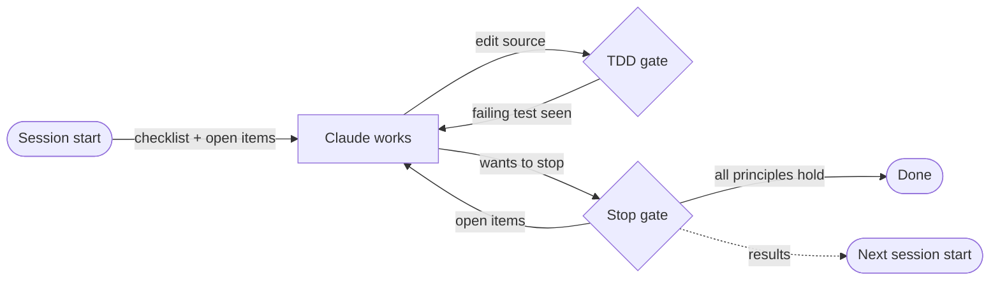
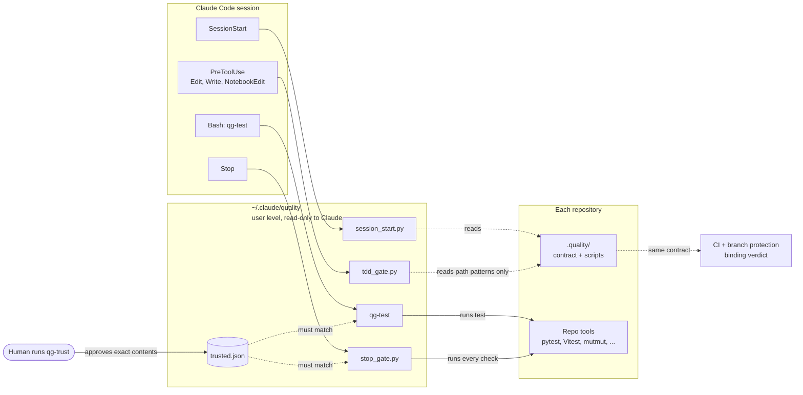
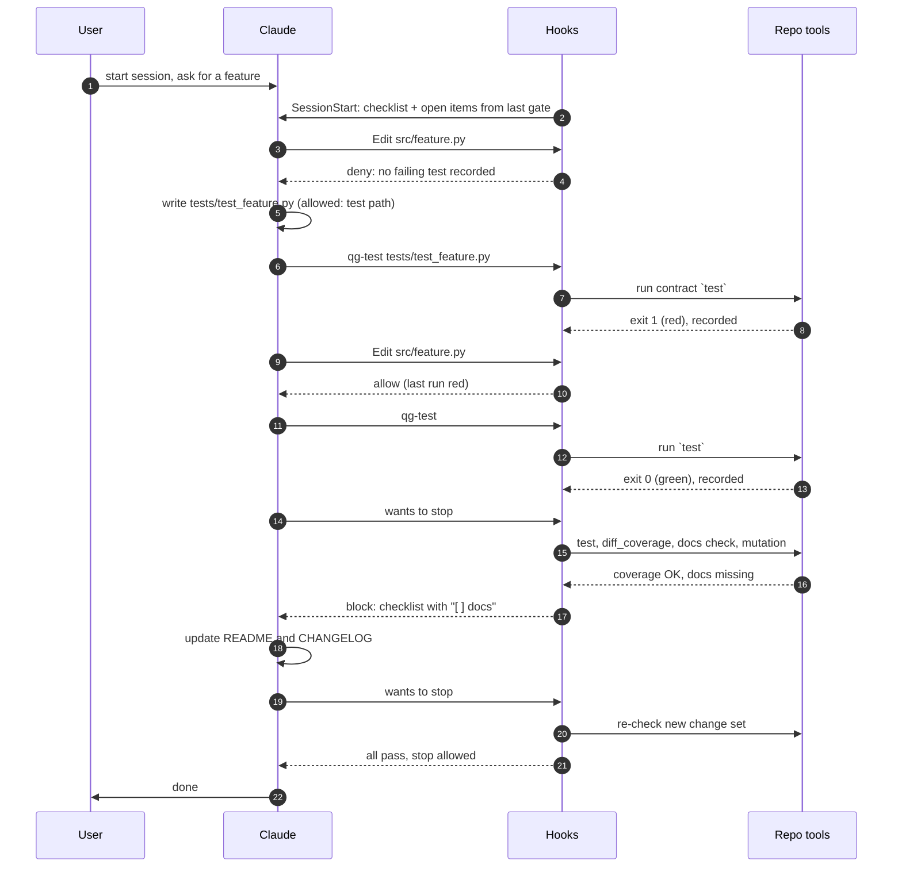
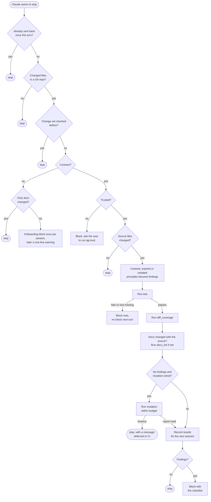
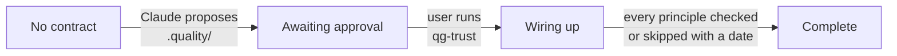

# Quality gate

A set of Claude Code hooks that build a **development methodology** into every session, in every
repository: test-first development, tests for every changed line, tests that actually catch bugs,
and documentation that keeps up with the code. The hooks contain no language-specific tooling.
Each repository declares how its own stack checks the principles, and Claude sets that up itself
the first time a check is missing.

- **Source:** this directory (`quality/`), installed to `~/.claude/quality/` by `mise run sync`.
- **Onboarding guide used by Claude in a repository:** [`templates/README.md`](templates/README.md).
- **Tests:** `mise run test` runs [`tests/smoke.sh`](tests/smoke.sh).

## Contents

- [In one minute](#in-one-minute)
- [Getting started](#getting-started)
- [Glossary](#glossary)
- [Why it exists](#why-it-exists)
- [The four principles](#the-four-principles)
- [Architecture](#architecture)
- [Design rules](#design-rules)
- [The quality contract](#the-quality-contract)
- [A session, start to finish](#a-session-start-to-finish)
- [The three hooks in detail](#the-three-hooks-in-detail)
- [How a repository brings itself up](#how-a-repository-brings-itself-up)
- [Trust and security](#trust-and-security)
- [State and files](#state-and-files)
- [Configuration](#configuration)
- [Installing, testing and changing the gate](#installing-testing-and-changing-the-gate)
- [FAQ](#faq)
- [Limitations](#limitations)

## In one minute

Three hooks run in every Claude Code session that starts inside a Git repository:

1. **At session start** Claude receives a checklist: which principles this repository checks,
   which it skips and until when, and what the last check left open.
2. **Before Claude edits source code**, it must have seen a failing test (red before green).
3. **When Claude wants to end its turn**, the gate runs the repository's own checks on everything
   that changed. If something is open, Claude is sent back with the same checklist.

What a repository checks lives in one file, `.quality/contract.toml`. A human approves that file
before any of its commands run. In a repository without a contract, Claude is asked to propose
one; when a check or tool is missing, Claude is told to install it. So the gate brings itself up,
repository by repository, without anyone having to remind Claude.



## Getting started

**Prerequisites:** Claude Code, Git, [uv](https://docs.astral.sh/uv/) (runs the hook scripts),
and for installing from this repository: mise, jq and rsync.

**Install:** in this repository, run `mise run sync`. New Claude Code sessions pick up the hooks.

**First use in a repository** goes like this. You do steps 3 and 4; Claude does the rest.

1. Claude changes code. When it wants to stop, the gate asks it to propose a contract.
2. Claude writes `.quality/contract.toml` and helper scripts, based on
   [`templates/README.md`](templates/README.md).
3. Each file Claude writes in `.quality/` shows you a permission prompt. Approve what you agree
   with.
4. Review `.quality/` and run `~/.claude/quality/qg-trust` in your own terminal.
5. If a principle has no check yet or a tool is missing, the next stop says so and Claude wires it
   up. Every change to `.quality/` needs `qg-trust` again.
6. From then on, Claude works test-first and the gate checks every change.

## Glossary

| Term               | Meaning                                                                                          |
|--------------------|--------------------------------------------------------------------------------------------------|
| Hook               | A command Claude Code runs at a fixed moment. It can add context, or allow or stop an action     |
| SessionStart       | Hook event when a session starts, resumes, is cleared, compacted or forked                       |
| PreToolUse         | Hook event before Claude uses a tool, here a file edit                                           |
| Stop               | Hook event when Claude wants to end its turn. The hook can send Claude back to work              |
| allow / ask / deny | PreToolUse decisions. *ask* shows **you** a permission prompt; *deny* refuses and tells Claude why |
| Block              | A Stop hook sending Claude back with a reason. Claude reads it and continues working             |
| Red / green        | A test run that fails (red) or passes (green)                                                    |
| Change set         | All files changed since the start point (see [Stop](#stop-verify)), committed or not             |
| Merge-base         | The last commit two branches have in common                                                      |
| Diff coverage      | The share of *changed* lines executed by tests, rather than of the whole codebase                |
| Mutation testing   | Deliberately breaking the changed code and checking that the tests notice                        |
| Contract           | `.quality/contract.toml`: how this repository checks each principle                              |
| Wired / unwired    | A principle with a command in the contract / without a command or a valid skip                   |
| Skip               | A dated, explained opt-out of one principle                                                      |
| `<git-dir>`        | The repository's `.git` directory (or a worktree's Git directory)                                |
| Seat               | A Claude Code config directory. This setup has two: `~/.claude` and `~/.claude-dpg`              |
| doc-auditor        | A read-only subagent that compares the docs with the diff and reports what is stale              |

## Why it exists

Without enforcement, an AI coding agent drifts in predictable ways: it writes code before tests,
leaves changed lines untested, writes tests that pass whatever the code does, and forgets the
docs. A human then has to remind it every session. Instructions in `CLAUDE.md` help, but nothing
checks that they were followed.

The gate turns those instructions into feedback the agent cannot miss. Two constraints shaped it:

- **It runs everywhere.** These are user-level hooks, active in every repository and language.
  They must help far more than they get in the way, and cannot assume any tool is installed.
- **It enforces principles, not tools.** "Changed lines are covered by tests" is the rule. Whether
  that means pytest + diff-cover or Vitest + LCOV is the repository's choice.

## The four principles

| Principle            | Meaning                                                  | Contract key    | How the gate checks it                                       |
|----------------------|----------------------------------------------------------|-----------------|--------------------------------------------------------------|
| TDD                  | Implementation is only written after a failing test      | `test`          | Red/green state recorded by `qg-test`; suite must be green   |
| Tests written        | Every changed source line is covered by a test           | `diff_coverage` | Exit code of the repository's diff-coverage command          |
| Tests are meaningful | Tests fail when the changed code is broken on purpose    | `mutation`      | Mutation score from a normalised JSON report vs. a threshold |
| Docs up to date      | User-visible changes are reflected in docs and CHANGELOG | `docs_lint`     | Docs changed with the source, optional linter, doc-auditor   |

A mutation tool makes small deliberate bugs ("mutants") in the changed code, such as flipping
`<` to `<=`, and reruns the tests. A mutant the tests do not catch "survives". A high share of
killed mutants shows the tests check behaviour, not just execute it.

## Architecture

The gate has three layers: Claude Code and its hook events, the user-level gate scripts in
`~/.claude/quality/`, and each repository's contract and tools.



| Component          | Role                                                                                     |
|--------------------|------------------------------------------------------------------------------------------|
| `session_start.py` | SessionStart hook. Resets TDD state, anchors the change set, injects the checklist      |
| `tdd_gate.py`      | PreToolUse hook on file edits. Protects gate files, enforces red before green            |
| `stop_gate.py`     | Stop hook. Checks every principle for the change set, sends Claude back if needed        |
| `qg-test`          | How Claude runs tests (by instruction). Runs the contract's `test`, records red or green |
| `qg-trust`         | Human-only approval of a repository's `.quality/` directory                              |
| `qglib.py`         | Shared logic: Git, contract parsing, principle status, trust, change set, command runner |
| `templates/`       | Onboarding guide and the Python reference adapter                                        |
| `doc-auditor`      | Read-only subagent (`~/.claude/agents/doc-auditor.md`) that audits docs against the diff |

Two properties of this layout matter:

- **The TDD gate executes nothing from the repository.** It only reads path patterns, so it is
  safe even for a repository you just cloned.
- **`qg-test` and the Stop gate run repository commands only after `qg-trust`.** Contract commands
  are shell commands, with the same risk as any script in a cloned repository.

All scripts are Python 3.11+ using only the standard library. They run through `uv run --script`
(each has a PEP 723 header), so they work whatever Python a repository pins.

## Design rules

Every part of the implementation traces back to one of these rules.

1. **Principles in the hooks, tooling in the repository.** Hooks never call a language tool. They
   run the commands a repository declares and read exit codes and one JSON report.
2. **Hooks give feedback; CI decides.** Hooks run locally and can be bypassed. They save rework.
   Only CI with branch protection can stop a merge.
3. **Deterministic first, LLM second.** Cheap checks decide *when* to act. The doc-auditor (an
   LLM) only runs when the docs check fires.
4. **Don't nag.** A finding about a change set is raised once. Only failing tests and missing
   tools are raised again, because they must be fixed rather than argued with.
5. **Claude cannot weaken its own gate.** A human approves every version of a contract. Gate
   scripts and gate state are protected from edits by Claude.
6. **Bring yourself up.** A missing contract, an unwired principle or a missing tool is a task for
   Claude, not a dead end for the user.
7. **Remember at the start, verify at the end.** One principle list drives both the session-start
   checklist and the Stop gate, and open items carry over to the next session.
8. **Skips are debt.** Opting out of a principle needs a reason and an expiry date, and can be
   limited to the part of the code that needs it.

## The quality contract

One file per repository, `.quality/contract.toml`, with helper scripts next to it in `.quality/`.
Generated output goes to `.quality/out/`. That directory is excluded from the trust hash, and the
repository must add it to `.gitignore`; otherwise reports show up as changes.

```toml
version = 1
base = "origin/main"            # optional; see "Change set" below for the default

[paths]                          # fnmatch globs on repo-relative paths; `*` also matches `/`
source = ["src/**"]
tests  = ["tests/**", "**/test_*.*", "**/*_test.*"]
docs   = ["README*", "CHANGELOG*", "docs/**", "adr/**"]   # required in practice, see below

[commands]                       # run by sh with the repo root as working directory
test          = "./.quality/test.sh {args}"           # required
diff_coverage = "./.quality/diff_coverage.sh {base}"  # required
docs_lint     = "uv run pydoclint src"                # optional
mutation      = "uv run python .quality/mutation.py {base}"

[mutation]
report         = ".quality/out/mutation.json"
threshold      = 0.8   # minimum killed / (killed + survived)
budget_seconds = 240   # in-session time box; CI runs without it
stage          = "stop" # or "pre-push": the Stop gate skips it, the pre-push hook runs qg-mutation
skip_paths     = { paths = ["src/legacy/**"], reason = "...", until = 2026-12-31 }  # optional
```

| Command         | Must do                                                                                 | Exit code                      |
|-----------------|-----------------------------------------------------------------------------------------|--------------------------------|
| `test`          | Run the suite, or only the tests in `{args}`; fast enough for a TDD loop                | 0 = pass                       |
| `diff_coverage` | Run tests with coverage; fail when lines changed since `{base}` are under the threshold | 0 = pass                       |
| `docs_lint`     | Static doc checks (docstrings, signature drift, links)                                  | 0 = pass                       |
| `mutation`      | Mutation-test code changed since `{base}`; write the report                             | ignored, except "tool missing" |

- **Placeholders.** `{base}` becomes the start commit of the change set, `{args}` the
  shell-quoted arguments given to `qg-test`.
- **Mutation report.** Two required integers. Timeouts count as killed; zero mutants passes.

  ```json
  {"killed": 42, "survived": 7, "tool": "mutmut 3.8.0", "survivors": ["pkg.mod.fn__mutmut_3"]}
  ```

- **Paths.** A file matching both `source` and `tests` counts as a test. A pattern starting with
  `**/` also matches at the repository root. Without `paths.docs`, no change ever counts as a docs
  change, so the docs check fails on every source change.
- **Thresholds** live in the contract and its scripts, so lowering one needs a human to approve
  the contract again.

### Skips

Each of `test`, `diff_coverage` and `mutation` is either a command or a **dated skip**:

```toml
mutation = { skip = "no mature mutation tool for this stack yet", until = 2026-12-31 }
```

| Skip state                                  | Shown as                           | Gate treats it as      |
|---------------------------------------------|------------------------------------|------------------------|
| `until` today or later, at most 90 days out | `skipped until <date>: <reason>`   | skipped                |
| `until` in the past                         | `skip expired on <date>: <reason>` | unwired: wire or renew |
| No `until`, or more than 90 days out        | `undated skip: <reason>`           | unwired: add a date    |

`[mutation] skip_paths` is the partial form. A change that only touches those paths does not
trigger mutation testing; a change anywhere else in the source still does. It expires the same
way. Slowness is never a valid reason to skip: a slow mutation run is deferred to CI on its own.

### Mutation on pre-push

`[mutation] stage = "pre-push"` takes mutation testing out of the Stop gate, which then records it
as deferred and never runs it. The repository's pre-push hook calls `~/.claude/quality/qg-mutation`
instead: it runs the `mutation` command for the commits being pushed (base: its argument, else the
merge-base with the contract's `base`), applies the threshold without a time budget, and exits 0
on pass, 1 below the threshold or with no valid report, 3 on an untrusted contract. Use it when a
run takes minutes: a Stop gate that runs it every turn costs more than it catches.

A mutation tool that rewrites sources in place (Cosmic Ray) must run in a throwaway worktree: a run
killed mid-mutant otherwise leaves the mutant in the shared checkout, where parallel sessions test
and commit it.

## A session, start to finish

One feature, built in a repository with a trusted contract:



**What Claude reads at step 2** (this repository; lines shortened with `...`):

```text
Quality principles for this repository (.quality/contract.toml):
- [checked] test: TDD: write a failing test first, run it through qg-test, ...
- [skipped until 2027-01-15: hooks run as uv subprocesses; ...] diff_coverage: ...
- [skipped until 2027-01-15: no mutation tool wired for ...] mutation: ...
- [checked] docs: user-visible changes are reflected in README, docs, ...
Skips are debt: when your change touches a skipped area, try to wire the check.
Work test-first: write a failing test, run tests only through `~/.claude/quality/qg-test`, ...
Before you finish, verify each principle for your change; the Stop gate checks the same ...
```

**What a Stop-gate block looks like** (`[x]` passed, `[ ]` open with the reason indented below
it, `[-]` skipped):

```text
Quality gate for this change set. Fix each open item, or explain in one or two sentences ...
[x] test
[x] diff_coverage
[ ] mutation
    Mutation score 50% is below 80% (5 of 10 mutants survived). Strengthen the assertions so the
    tests fail for these mutants: ...
[x] docs
```

Claude sees these texts; you see the conversation continue. The gate only interrupts you with an
*ask* permission prompt (see the TDD gate) or a request to run `qg-trust`.

## The three hooks in detail

### SessionStart: remember

Runs on every session start, resume, clear, compact and fork (timeout 20 s).

1. Outside a Git repository: do nothing.
2. On a fresh session (`startup` or `clear`): delete the TDD state, so no session inherits a red
   test. `resume`, `compact` and `fork` keep it.
3. Record the session's starting `HEAD`, so work committed or pushed during the session still
   counts as part of the change set.
4. No contract: one line listing the principles, asking Claude to propose a contract if it changes
   code.
5. Contract present: the checklist, any partial skip, a reminder that skips are debt, open items
   from the last Stop gate, and how to run tests (or, if the contract is untrusted, to ask you for
   `qg-trust`).

### PreToolUse: the TDD gate

Fires before `Edit`, `Write` and `NotebookEdit` (timeout 20 s). The first matching rule wins.

| #  | Target file                                                         | Decision                                                |
|----|---------------------------------------------------------------------|---------------------------------------------------------|
| 1  | Inside the gate directory (`QG_HOME`, normally `~/.claude/quality`) | **deny**: gate scripts                                  |
| 2  | Outside any Git repository                                          | allow                                                   |
| 3  | Inside `<git-dir>/qg/`                                              | **deny**: gate state                                    |
| 4  | Inside `.quality/` (except `.quality/out/`)                         | **ask**: you see the change                             |
| 5  | No contract, `test` skipped or unwired, or contract not trusted yet | allow                                                   |
| 6  | `QG_TDD=off`                                                        | allow, logged to `bypass.log`                           |
| 7  | Not a source file, or a test file                                   | allow                                                   |
| 8  | Last `qg-test` run was red                                          | allow: Claude is making a test pass                     |
| 9  | Last run was green                                                  | **ask** "refactor only?"; **deny** with `QG_TDD=strict` |
| 10 | No run recorded this session                                        | **deny**: write a failing test first                    |

The check is per state, not per edit: one red run allows edits to any source file until the next
`qg-test` run turns green. Use `QG_TDD=strict` for unattended `claude -p` runs, where nobody can
answer an *ask*.

### Stop: verify

Runs every time Claude wants to end its turn (timeout 900 s).



**Change set.** The start point is the common ancestor of two commits: the merge-base of `HEAD`
with `base`, and the `HEAD` the session started at. Everything after it counts, committed or not,
plus untracked files. `base` defaults to the remote's default branch (`origin/HEAD`, then
`origin/main`, then `origin/master`). Without a remote branch it falls back to `HEAD`, so only
uncommitted work and the session's own commits count.

**When the gate blocks, and when again.** The gate stores a fingerprint (SHA-256 of the diff plus
untracked files) of every change set it finished checking. *Already sent back once this turn* is
Claude Code's `stop_hook_active` flag, so there is at most one block per turn.

| Outcome                                                    | What happens                                             |
|------------------------------------------------------------|----------------------------------------------------------|
| Tests fail or time out                                     | Block; checked again at every Stop until they pass       |
| A tool is missing (any principle)                          | Block; checked again at every Stop until it is installed |
| Coverage, docs, mutation, unwired or expired-skip findings | Block once for this change set                           |
| Contract not trusted                                       | Block once for this change set                           |
| No contract, code changed                                  | Block once per session; later one warning per change set |
| Mutation run over its budget                               | Message "deferred to CI", no block                       |
| `[mutation] stage = "pre-push"`                            | Mutation not run; `qg-mutation` checks it on push        |
| Only docs or tests changed, or nothing changed             | Silent                                                   |

**Order and time limits.** Tests run first: if they fail, nothing else is worth running. Then
diff coverage (300 s), then docs (`docs_lint` 60 s). Mutation testing, the most expensive check,
only runs when everything else is clean, within `budget_seconds`. `test` has 240 s, and a timeout
is reported as failing tests. With the default budget the steps add up to 840 s, under the hook's
900 s, so keep `budget_seconds` below about 300 or raise the hook timeout too. `qg-test` itself has
no timeout.

**Missing tools.** A command counts as "tool missing" when it exits 126 or 127, or exits non-zero
with one of these messages in the last 4000 characters of output: "Failed to spawn" (uv),
"command not found", "could not determine executable to run" (npx), "error: no such command"
(cargo), "executable file not found". Claude is then told to install the tool, never that tests
fail. `qg-test` records no red/green state in that case.

**Docs.** If no changed file matches `paths.docs`, Claude is asked to run the doc-auditor
subagent and update the docs, or to state why no update is needed. An optional `docs_lint` adds
static checks. In a repository without a contract, "only docs changed" means every changed file
is a `.md` file (anywhere) or under `docs/`.

## How a repository brings itself up

Nobody sets the gate up by hand. Each stage tells Claude what the next step is.



Two events move a repository back: any change to `.quality/` returns it to *awaiting approval*,
and an expired skip returns it to *wiring up*.

| Stage             | What you see                                            | What Claude does                                                  |
|-------------------|---------------------------------------------------------|-------------------------------------------------------------------|
| No contract       | Nothing until Claude stops after changing code          | Proposes a contract from `templates/README.md`                    |
| Awaiting approval | Prompts for `.quality/` files; a request for `qg-trust` | Keeps working; the TDD gate waits for the approval                |
| Wiring up         | Nothing, unless Claude needs a decision                 | Picks a tool, installs it, adds the command, or skips with a date |
| Complete          | Nothing, unless a change breaks a principle             | Works test-first and fixes findings                               |

Quality tooling (test runners, coverage, mutation tools, doc linters) is pre-approved in the user
instructions as dev-only dependencies, so Claude installs it without asking.

## Trust and security

Contract commands are shell commands written by whoever controls the repository: a teammate, a
cloned project, or Claude itself. The trust model makes sure a human has seen every version
before it runs.

- **`qg-trust` approves exact contents.** It prints every file in `.quality/` (except `out/`),
  asks for `yes` on an interactive terminal, and stores one SHA-256 over all those files in
  `~/.claude/quality/trusted.json`. Any change to any file in `.quality/` gives a new hash that
  needs a new approval.
- **Approvals belong to the repository, not the folder.** They are keyed by the repository's
  common Git directory, so every worktree shares them. A worktree whose `.quality/` matches any
  of the last 20 approved versions is trusted without asking again; a worktree that changes
  `.quality/` needs its own `qg-trust`. Approvals stored per folder by older versions still count.
- **Only a human can approve.** `qg-trust` refuses to run without a terminal, and the permission
  rule `Bash(*qg-trust*)` denies it to Claude (it also stops Claude from merely reading the
  script with `cat`).
- **Claude cannot edit the gate.** Permission rules deny edits to `~/.claude/quality/**` and to
  both seats' `settings.json`. The TDD gate also denies edits to gate scripts and gate state, and
  asks you before any `.quality/` edit.
- **Untrusted contracts are read, never run.** Path patterns and skips are read from any
  contract, because reading executes nothing.

**Known local bypasses**, accepted because CI is the binding control:

- Claude can write files through Bash (`sed -i`, redirects), which the edit hook does not see.
  The Stop gate still checks the result.
- A developer can remove the hooks, set `QG_TDD=off` (logged), or run without this configuration.
- Any failing `qg-test` run counts as red, even a syntax error. Mutation testing and review judge
  test quality; a deterministic gate cannot.
- In this repository Claude can change `quality/` and run `mise run sync`. Accepted: sessions
  here are about the gate itself, and every change is visible in Git.

Protect `.quality/` and `.claude/` in pull requests with a CODEOWNERS entry, as with CI workflows.

## State and files

Per repository, in `<git-dir>/qg/` (never committed, denied to Claude):

| File                  | Written by         | Purpose                                                        |
|-----------------------|--------------------|----------------------------------------------------------------|
| `tdd.json`            | `qg-test`          | Last test run: red or green, time, selectors                   |
| `session-<id>.head`   | `session_start.py` | `HEAD` at session start; anchors the change set (never pruned) |
| `stop-digest`         | `stop_gate.py`     | Fingerprint of the last checked change set                     |
| `last-gate.json`      | `stop_gate.py`     | Per-principle results; open items at the next session start    |
| `onboarded-<session>` | `stop_gate.py`     | Onboarding block already shown in this session                 |
| `bypass.log`          | `tdd_gate.py`      | Edits made with `QG_TDD=off`                                   |

User level, in `~/.claude/quality/`: the scripts, `templates/`, and `trusted.json` (approvals).

## Configuration

Environment variables, read from the environment Claude Code was started in:

| Variable              | Values                            | Default             | Effect                                                                     |
|-----------------------|-----------------------------------|---------------------|----------------------------------------------------------------------------|
| `QG_TDD`              | `on`, `strict`, `off`             | `on`                | `strict` denies instead of asking; `off` disables the TDD gate (logged)    |
| `QG_MISSING_CONTRACT` | `onboard`, `warn`, `block`, `off` | `onboard`           | Repo without a contract, see below                                         |
| `QG_HOME`             | directory                         | `~/.claude/quality` | For tests: moves `trusted.json` and the protected directory, not the hooks |
| `QG_TODAY`            | `YYYY-MM-DD`                      | today               | Fixed date for skip expiry; used by the tests                              |

`QG_MISSING_CONTRACT` in a repository without a contract, when code changed: `onboard` blocks
once per session and warns after that; `warn` only warns; `block` blocks once per change set;
`off`, and any unknown value, does nothing.

Hooks and permission rules are registered in `generic_settings.json`: SessionStart and PreToolUse
(`Edit|Write|NotebookEdit`) with a 20 s timeout, Stop with 900 s. The hook commands use the fixed
path `$HOME/.claude/quality`.

## Installing, testing and changing the gate

**Install or update.** Change files in this repository, then run `mise run sync`:

- `quality/` is mirrored to `~/.claude/quality/` with `rsync --delete`, without `tests/` and
  without touching `trusted.json`. There is one install, shared by both seats, so approvals are
  shared too.
- All `agents/*.md` and `hooks/*.sh` and the user instructions go to both seats.
- `generic_settings.json` is merged into both seats' `settings.json` at the top level, with the
  repository winning. The whole `hooks` and `permissions` objects are replaced, so hooks added by
  hand to a seat are lost.

**Test.** `mise run test` runs the smoke tests: throwaway repositories with `sh`-based contract
commands, a temporary `QG_HOME` and a fixed `QG_TODAY`. They never touch the real trust file.
Gaps are listed under [Limitations](#limitations).

**Change.** This repository is gated by its own contract
([`.quality/contract.toml`](../.quality/contract.toml)), so changes follow the method they
enforce:

1. Add a failing case to `tests/smoke.sh` and run `~/.claude/quality/qg-test` (red).
2. Change the scripts until it passes (green).
3. Update this document and the onboarding guide.
4. Commit, then `mise run sync`.

## FAQ

**Claude was denied an edit with "no failing test recorded".** Working as intended: Claude should
write or extend a test, run it through `qg-test` and see it fail. For a pure refactor, Claude runs
`qg-test` first; on green the gate asks you instead of denying.

**The gate asks me to run `qg-trust`.** Something in `.quality/` changed. Review the files, then
run `~/.claude/quality/qg-trust` in your own terminal from the repository root.

**Mutation testing never runs.** Check in order: is `mutation` a command rather than a skip; did
the change touch `paths.source` outside any `skip_paths`; were there other findings (mutation only
runs when everything else is clean); did it exceed `budget_seconds` (look for "deferred to CI").

**Every new worktree asks for `qg-trust`.** Approvals are shared across worktrees by content,
so this only happens when the worktree's `.quality/` differs from every approved version, or for
the first approval after upgrading from per-folder approvals. Run `qg-trust` once in any worktree
of the repository.

**The gate says a tool is missing, but it is installed.** Run the contract command by hand from
the repository root, with `sh`, to see what the shell finds.

**The change set includes old commits.** It reaches back to the merge-base with `base` or the
session start, whichever lies further back. Set `base` in the contract if the default branch is
detected wrongly.

**Bypass and reset.** `QG_TDD=off` disables the TDD gate for as long as it is set in the
environment Claude Code was started from (each bypassed edit is logged).
`QG_MISSING_CONTRACT=off` silences onboarding. Deleting `<git-dir>/qg/` resets all gate state
for a repository.

**Two blocks at once in a repository without a contract.** The older `hooks/docs-stop.sh` and the
onboarding block can fire in the same Stop. `docs-stop.sh` stays quiet once a contract exists.

## Limitations

- **No CI runner yet.** The design makes CI the binding verdict on the same contract, but a CI
  runner script is not part of this repository yet. Until then, the hooks are feedback only.
- **Python is the only tested adapter.** The other ecosystems in the onboarding guide are starting
  points, and the mutmut 3 report format has not been verified against a real project.
- **Smoke-test gaps:** TDD rules 2, 3 and 7; `docs_lint`; `QG_MISSING_CONTRACT` values other than
  the default; missing tools in `diff_coverage` or `mutation`; an invalid mutation report.
- **Unverified Claude Code behaviour:** whether a Stop hook's message is shown, how two Stop hooks
  that both block are combined, and the exact `~` and `**` semantics of the
  `Edit(~/.claude/quality/**)` deny rule (the TDD gate is the effective guard).
- **One session at a time per repository.** Concurrent sessions in one repository share
  `<git-dir>/qg/` and can overwrite each other's red/green state.
